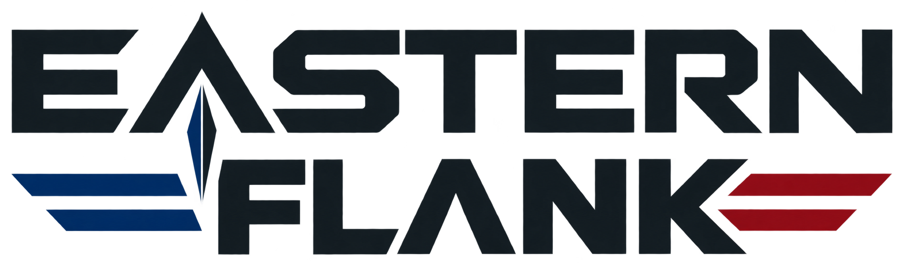

<h1 align="center">
  <picture>
    <source media="(prefers-color-scheme: dark)" srcset="assets/branding/logo_light.png">
    
  </picture>
</h1>

Turn-based tactical 3D strategy on hexes – Godot 4 (GDScript), developed with the help of AI agents (Claude Code).

## Getting started

```bash
tools/install_godot.sh            # or your own Godot 4.5+ as `godot` on PATH
pipx install "gdtoolkit==4.*"     # gdformat + gdlint (optional, recommended)
tools/check.sh                    # lint + headless tests
tools/run.sh                      # game   (tools/run.sh --editor – editor)
```

Prototype controls: LMB – select unit / move, Enter – end turn, WASD/arrows – camera, Q/E – rotate, mouse wheel – zoom.

## Documentation

- [docs/GDD.md](docs/GDD.md) – game design
- [docs/ARCHITECTURE.md](docs/ARCHITECTURE.md) – architecture and directory layout
- [docs/AGENTIC_WORKFLOW.md](docs/AGENTIC_WORKFLOW.md) – how we work with agents
- [docs/tasks/BACKLOG.md](docs/tasks/BACKLOG.md) – tasks
- [CLAUDE.md](CLAUDE.md) – instructions for agents
