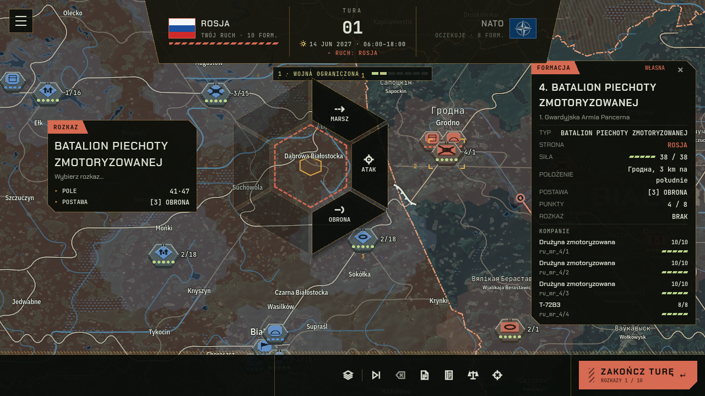
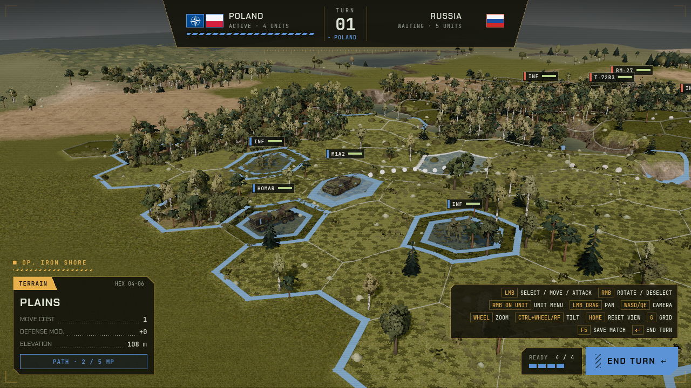

<p align="center">
  
  
</p>

Turn-based strategy on hexes about a present-day NATO–Russia confrontation on Europe's eastern flank – Godot 4 (GDScript), developed with the help of AI agents (Claude Code).

▶ [Watch the teaser on YouTube](https://www.youtube.com/watch?v=7AtP7r6CWlg) – a Homar-K salvo, recorded in the game.

<p align="center">
  
  
</p>

## The idea

The player runs a real military operation, not a series of disconnected battles. Decision realism comes first: every serious decision has a cost, a risk and consequences. The game has two layers ([docs/VISION.md](docs/VISION.md)):

- **Operational map** (the main scene) – a staff map of the Suwałki theatre (north-east Poland, the Kaliningrad oblast, southern Lithuania, western Belarus; about 340 × 277 km, 5 km hexes). Formations get multi-turn orders (march, attack, defend); countries have stances, and crossing a border or striking a sensitive target has political consequences. Planned: logistics, reconnaissance, air defence and EW, deep strikes with lasting effects, a technology tree, mobilisation and political events.
- **Tactical map** (battle) – when formations make contact, a classic I-go-you-go battle starts on a 3D hex map at platoon/company level, in conditions shaped by the operation. Its result (losses, retreat, readiness, an after-action report) goes back to the operational map. Planned after the MVP: drones, EW, counter-battery fire, helicopters, aircraft, mining, fortifications.

The hex grid is only the rules grid (movement cost, country, contact). The maps are drawn realistically from real geography – OpenStreetMap land cover and Copernicus elevation – never bent to the hexes ([ADR 0018](docs/adr/0018-maps-from-real-geography.md)).

## What works today

- **Battle:** command points, movement, ranged and melee combat with per-element rolls and counterattacks, terrain and elevation, victory conditions (annihilation, objective battle), an AI opponent, replayable match records. Real units with their own stats and procedural 3D models: Poland (mechanised infantry, M1A2 SEPv3 Abrams, Homar-K) vs. Russia (motor rifle squad, T-72B3, 9K57 Uragan). Scenarios: default battle, objective battle and a Suwałki battle on a real-terrain tactical layer.
- **Operational map:** the Suwałki staff map with relief, coast, rivers, roads, borders and place names; formations with orders and route planning; countries, stances and the escalation ladder; hand-off to a battle and back; saving the operation.
- **Presentation:** a HUD following the Claude Design mockups ([docs/design/](docs/design/)), sound effects and ambience, a unit catalog of real equipment.
- Everything else (the full list of what is *not* in yet) is in [section 13 of the manual](docs/MANUAL.md); planned work is in [docs/tasks/BACKLOG.md](docs/tasks/BACKLOG.md).

## Getting started

```bash
tools/install_godot.sh            # or your own Godot 4.5+ as `godot` on PATH
pipx install "gdtoolkit==4.*"     # gdformat + gdlint (optional, recommended)
tools/check.sh                    # lint + headless tests
tools/run.sh                      # game   (tools/run.sh --editor – editor)
```

Under WSL use `tools/run_windows.sh` for GPU rendering. `tools/run.sh --scene=staff_map` opens the operational map directly, `--scenario=suwalki_battle` the Suwałki battle.

### Controls

| | Battle | Operational map |
|---|---|---|
| Select | LMB on a unit | LMB on a formation counter (Tab – next) |
| Move / order | LMB on a highlighted hex | LMB on a hex – march; on an enemy – attack |
| Action ring | RMB on a unit (1 attack, 2 info) | RMB on a hex (March / Attack / Defend / Cancel) |
| End turn | Enter | Enter |
| Camera | WASD/arrows pan, Q/E rotate, wheel zoom, Ctrl+wheel tilt | WASD/arrows/drag pan, wheel zoom, Ctrl+wheel or Q/E tilt, V flat/tilted |
| Toggles | G grid | G grid, N place names, B borders |
| Save | F5 (match record) | F5 (the operation) |

Full list: [docs/MANUAL.md](docs/MANUAL.md).

## Under the hood

- **Pure-logic core.** `src/core/` and `src/ai/` have no nodes, scenes or autoloads, so everything is testable headless and deterministic (one seeded RNG in the game state).
- **Everything is a command.** State changes only through `Command`s run by `GameSimulation`; the player, the AI and replays use the same path. The view only reads state and reacts to events.
- **Data-driven.** Units, factions, terrain, countries and scenarios live in `data/**/*.tres`; maps are imported from real data by `tools/import_map.py`.
- **Tests first.** Each rule has a headless test in `tests/unit/`; the project aims at 60 FPS on the target GPU.

Details: [docs/ARCHITECTURE.md](docs/ARCHITECTURE.md), [docs/CODEMAP.md](docs/CODEMAP.md) (a one-line map of `src/`), decisions in [docs/adr/](docs/adr/).

## Tools

| Tool | Purpose |
|---|---|
| `tools/check.sh` | lint + all tests |
| `tools/test.sh [filter]` | headless tests only |
| `tools/simulate.sh N` | headless AI-vs-AI matches for balancing |
| `tools/screenshot.sh`, `tools/readme_screenshot.sh` | render the battle / staff map to PNG |
| `tools/devtools.sh` | local hub: backlog viewer, unit catalog, tool runner, Claude chat |
| `tools/import_map.py` | build hex maps from OSM + Copernicus data |
| `tools/render_unit.sh`, `tools/unit_catalog.sh` | unit model rendering and the real-unit catalog |
| `tools/teaser.sh` | the promo video |

All tools and options: [docs/TOOLS.md](docs/TOOLS.md).

## Developing with agents

The agent cannot see the game window, so the project makes as much as possible verifiable as text without a GUI (pure logic, commands, determinism, data in resources, small tasks with acceptance criteria). Specialised subagents (game designer, gameplay engineer, presentation engineer, unit modeler, reviewer) are driven by the `/implement-task` skill; the human is product owner and playtester. See [docs/AGENTIC_WORKFLOW.md](docs/AGENTIC_WORKFLOW.md).

## Documentation

- [docs/VISION.md](docs/VISION.md) – vision: two maps, systems, MVP scope
- [docs/GDD.md](docs/GDD.md) – game design (decided rules)
- [docs/MANUAL.md](docs/MANUAL.md) – player's manual
- [docs/ARCHITECTURE.md](docs/ARCHITECTURE.md) – architecture and directory layout
- [docs/CODEMAP.md](docs/CODEMAP.md) – generated map of the source
- [docs/TOOLS.md](docs/TOOLS.md) – command-line tools
- [docs/AGENTIC_WORKFLOW.md](docs/AGENTIC_WORKFLOW.md) – how we work with agents
- [docs/adr/](docs/adr/) – architecture decision records
- [docs/design/](docs/design/) – visual design mockups
- [docs/tasks/BACKLOG.md](docs/tasks/BACKLOG.md) – tasks
- [CLAUDE.md](CLAUDE.md) – instructions for agents

## Credits

Downloaded assets are public domain (CC0) only, from [Poly Haven](https://polyhaven.com) and [ambientCG](https://ambientcg.com). Each file, with its author and source, is listed in [assets/third_party/credits.json](assets/third_party/credits.json) (rules: [ADR 0011](docs/adr/0011-third-party-assets.md)). Currently: sound effects and ambient loops (UI clicks by Kenney; tank cannon, explosions and bang sounds by rubberduck and Thimras; rifle shots from The Free Firearm Sound Library by Ben Jaszczak et al.; forest ambience by TinyWorlds; bird calls by pauliuw; all CC0, from [OpenGameArt](https://opengameart.org)), and the six terrain ground materials (grass, dry grass, forest floor, mud, gravel, rock) by Lennart Demes (ambientCG), Charlotte Baglioni, Rob Tuytel and Amal Kumar (Poly Haven).

Maps from real geography (`data/maps/`, [ADR 0018](docs/adr/0018-maps-from-real-geography.md)): land cover © [OpenStreetMap](https://www.openstreetmap.org/copyright) contributors (ODbL 1.0; the derived hex maps are offered under the ODbL as well), elevation from the Copernicus GLO-30 DEM – produced using Copernicus WorldDEM-30 © DLR e.V. 2010-2014 and © Airbus Defence and Space GmbH 2014-2018 provided under COPERNICUS by the European Union and ESA; all rights reserved. Details per map: [data/maps/CREDITS](data/maps/CREDITS).
