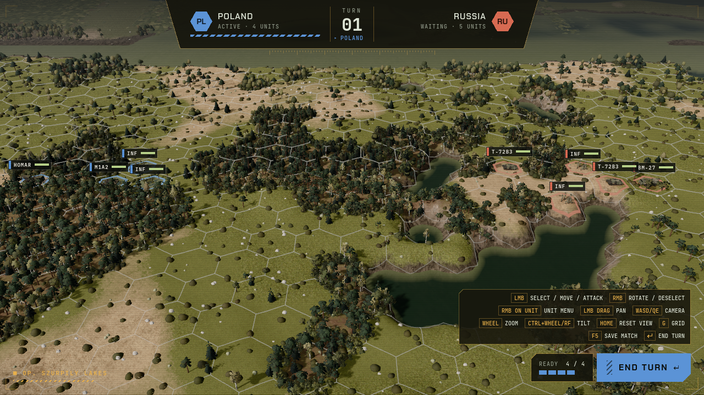

# TASK-087: Maps from real geography – data sources, hex scales, offline import tool (study + v1)

- **Status**: done
- **Layers**: tools (Python, offline) + core (map loading) + docs (ADR, credits)
- **Depends on**: – (soft: TASK-086)
- **Model**: opus (geodata, projection, determinism)

## Goal

Operational and tactical maps are generated from real map data of the eastern flank (GDD "Vision decisions"), so a battle is fought on the real terrain where formations met.

## Step 1 – study (decide with the human, write into the ADR)

- **Sources and licences**: OpenStreetMap land use / natural / roads / waterways (ODbL – attribution, share-alike of the derived database), elevation: Copernicus GLO-30 DEM (attribution) or Poland's GUGiK NMT (free, very detailed; check licence). Extends ADR 0011 and the credits manifest (`assets/third_party/` test or a `data/maps/CREDITS` equivalent).
- **Scales**: proposed operational hex ≈ 5 km, tactical hex ≈ 250 m (a company frontage); tactical map size per battle (e.g. 30×24 hexes ≈ 7.5×6 km) vs. TASK-072 performance. Show 2–3 options with numbers.
- **Projection**: one local metric projection per theatre (e.g. UTM 34N for the Suwałki Gap); hex ↔ lat/lon mapping stored with the map.
- **Classification**: OSM tags → today's terrain types (plains, forest, hills, water) and the new ones TASK-108 will add (fields, urban, marsh, roads, rivers); dominant-cover rule per hex; elevation per hex from the DEM mean, hills from local relief.
- **Workflow**: data downloaded once (cache outside git), generated maps committed as data, the game never goes online.

## Step 2 – v1 tool (after approval)

- [x] `tools/import_map.py <bbox> --hex=<m> --out=data/maps/<name>.tres` (stdlib + documented optional deps), deterministic: the same input gives byte-identical output (test).
- [x] The core loads such a map into `HexGrid` with per-hex terrain and elevation; `TerrainSurface` works with `field == null` (authored elevation) – test with a small committed sample map.
- [x] One real tactical sample (a few km around Suwałki or another spot the human picks) playable via a debug option, with a screenshot in the implementation notes.
- [x] Python tests run in `tools/check.sh`.

## Playtest (for the human)

1. Start the sample battle; compare forests, lakes and villages with a real map of the area.

## Player manual

Note that maps follow real terrain (credits / attribution in the manual or credits screen).

## Out of scope

New terrain types' rules (TASK-108), the operational map itself (TASK-092), map editor.

## Implementation notes

Step 1 decisions (human, 2026-10-31) are recorded with the options and numbers in [ADR 0018](../adr/0018-maps-from-real-geography.md): Copernicus GLO-30 DEM + OSM via Overpass (cache outside git, only generated maps committed, game offline), 250 m hex / 30×24 (option A of three), operational hex ≈ 5 km (documented only), UTM per theatre (34N here) with the mapping stored in the map, OSM → plains/forest/hills/water with dominant cover, DEM mean, hills from in-hex relief; fields/urban/marsh/roads/rivers mapping documented for TASK-108.

**Tool** – `tools/import_map.py` (Python 3.8 stdlib only: own GeoTIFF reader for the Copernicus deflate + floating-point-predictor tiles, Krüger UTM projection, scanline fill of OSM multipolygons; no optional deps needed). Downloads missing inputs into `~/.cache/eastern-flank/maps/` (`dem/<Copernicus tile>.tif`, `osm/osm_<s>_<w>_<n>_<e>.json`), `--offline` never downloads, `--dem` / `--osm` read given files. Same input → byte-identical `.tres` (tested; the real import was also re-run offline and `cmp`-identical). Tests: `tools/test_import_map.py` (19: projection vs. a numerically integrated meridian arc and the UTM scale factor, hex layout, GeoTIFF reader with/without predictor, OSM tag classes, ring assembly, even-odd fill, classification of the sample, determinism, golden file, cache lookup, offline failure), run by `tools/check.sh`. Synthetic fixtures in `tools/import_map_fixtures/` (re-made with `python3 tools/test_import_map.py --make-fixtures`) → golden `tests/fixtures/maps/sample_map.tres`.

**Core** – `ImportedMap` resource (`src/core/data/imported_map.gd`): `find(id)` (data/maps/<id>.tres), `problem()`, `to_grid()`, `metres_per_world_unit()`, `easting(p)` / `northing(p)` (floats, not Vector2 – float32 lost 0.5 m at UTM northings), `projected_to_tile(e, n)`. `HexGrid.authored_elevation` (set by `to_grid`): `TerrainSurface` with `field == null` then blends the three surrounding tile centres (smoothstep-weighted barycentric; through every centre, continuous across edges; hand-made grids stay flat per tile), and `MapGenerator.force_terrain` keeps a land tile's real elevation when it stays land. `HexGrid.set_elevation_m / has_elevation_m / elevation_m` carry the real DEM metres; the terrain panel shows them on real maps. `BattleSetup.map_id` may name an imported map (`Scenario.from_setup` loads it; `map_region` still unread, TASK-094). New scenario `suwalki_battle` (`Scenario.suwalki_battle[_setup]`, in `Scenario.NAMES`, so `tools/run.sh`, `tools/simulate.sh`, replays and devtools accept it): default forces, player 0 west / player 1 east, each company on the free real plains tile nearest its deployment column (front 9, back 7 from each edge); operation "Szurpily Lakes" (translated). No new events. Tests: `test_imported_map.gd` (16), `test_real_map_battle.gd` (10, incl. the credits check), plus additions in `test_scenario.gd`, `test_terrain_panel_model.gd`.

**Real vs. synthetic** – `data/maps/suwalki.tres` is REAL data: Copernicus tile N54 E022 and an Overpass extract downloaded 2026-10-31, centred on 54.235 N, 22.88 E (Suwałki Landscape Park around Szurpiły, ~15 km north of Suwałki): 439 plains, 131 hills, 126 forest, 24 water; heights 147–251 m. The town of Suwałki itself (tried first) is almost all urban plains, the Wigry area SE mostly forest and water; Szurpiły has lakes (Szurpiły, Jaczno corner), forest belts, villages and moraine hills. Tuning on the real data: hills threshold 15 m (12 m → 193 hills), exaggeration 1.5 (2.0 made Lake Szurpiły's banks ~1.1-unit cliffs; the lake lies 36 m above the map's lowest land). Everything under `tools/import_map_fixtures/` and `tests/fixtures/maps/` is SYNTHETIC. Many rural hexes are `.` (unmapped in OSM – in reality mostly fields); they are plains.

**Credits** – `data/maps/CREDITS` (OSM ODbL incl. share-alike statement for the derived hex data, Copernicus attribution, per-map inputs and rebuild command), `sources` in every map, README "Credits", manual §5 "Maps from real terrain".

**Screenshot** – `docs/images/suwalki_battle.png` (`SCREENSHOT_SCENARIO=suwalki_battle tools/screenshot.sh`, Windows D3D12 build): Lake Szurpiły right of centre with forested banks, forest belts west, hills in the north. On the RX 580 the grass density was cut to 0.89 to fit the instance budget (720 tiles = 6× the default map); FPS not measured – TASK-072.

**Follow-ups** – rasterise roads/rivers per hex (TASK-108), `map_region` cuts (TASK-094), lakes at different real heights all sit at the one water plane (banks become slopes), GUGiK DTM for exact Polish heights instead of the DSM canopy heuristic, a devtools job for the importer if the human wants one.
